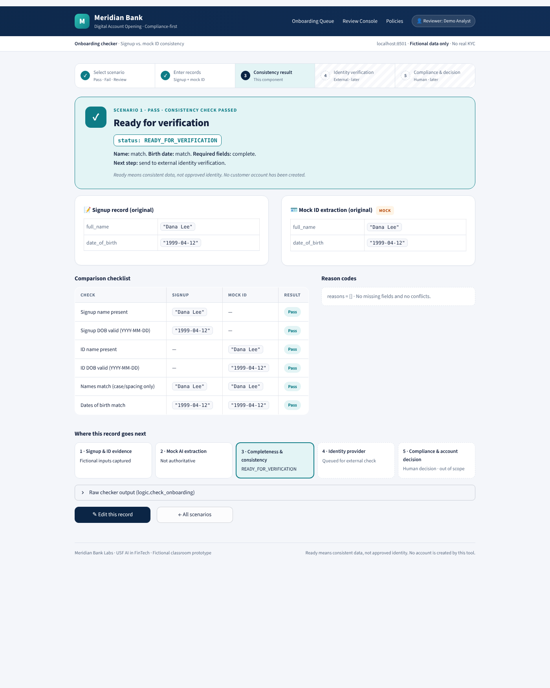
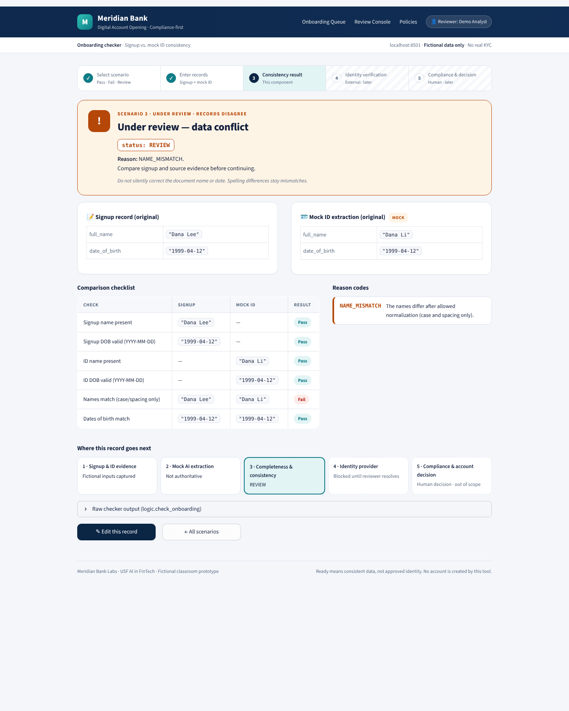

# Bank Account Onboarding Checker

*Meridian Bank Labs · fictional classroom prototype. Every name and date in this folder is invented.*

## Financial use case

A remote account-opening team must confirm that a customer's signup record agrees with the identity
information extracted from their ID document before the record goes to an external identity-verification
provider.

- **User:** an onboarding reviewer.
- **Decision:** is the record complete and consistent enough to send to external verification?
- **Inputs:** a fictional `signup` record and a mock `extracted_id` record, each with `full_name` and
  `date_of_birth` (`YYYY-MM-DD`). The extracted record is mock JSON standing in for a document extractor;
  it is not OCR.
- **Output:** `{"status": ..., "reasons": [...]}` from `logic.check_onboarding(signup, extracted_id)`, where status is:
  - `READY_FOR_VERIFICATION` with `reasons = []`, meaning the data is consistent, **not** an approved identity, or
  - `REVIEW` with ordered reason codes.

The screen shows three scenarios. `REVIEW` results go to one of two screens so that missing data and conflicting data look different:

| Screen | When | Status | Example reasons |
|---|---|---|---|
| **Pass** (teal) | Both records valid; name and DOB match | `READY_FOR_VERIFICATION` | `[]` |
| **Fail** (red) | A required field is missing or a date is invalid. No comparison is made | `REVIEW` | `MISSING_ID_DOB`, `INVALID_SIGNUP_DOB` |
| **Under review** (amber) | Valid records that disagree | `REVIEW` | `NAME_MISMATCH`, `DOB_MISMATCH` |

`logic.outcome_category()` only selects the screen. It never changes the status or the reasons.

## Run and test

**Prerequisites:** Python 3.12 or 3.13. The only dependency is pinned in `requirements.txt` (`streamlit==1.66.1`).
No API keys or configuration are needed, and no `.env` file is used. Run every command from this folder.

**macOS / Linux**
```bash
python3 -m venv .venv
.venv/bin/python -m pip install -r requirements.txt
.venv/bin/python -m unittest discover -s tests -v
.venv/bin/python -m streamlit run app.py
```

**Windows PowerShell**
```powershell
py -3 -m venv .venv
.\.venv\Scripts\python.exe -m pip install -r requirements.txt
.\.venv\Scripts\python.exe -m unittest discover -s tests -v
.\.venv\Scripts\python.exe -m streamlit run app.py
```

The app opens at **http://localhost:8501**. If Streamlit asks for an email on its first run, press Enter to skip.
Stop the server with Ctrl+C.

**Files**
```
app.py                 # Streamlit screens: scenarios → side-by-side form → Pass / Fail / Under review (no rules)
logic.py               # check_onboarding() and helpers; no Streamlit imports
tests/test_logic.py    # unittest checks: normal, failure, boundary, modification
data/examples.json     # fictional scenarios with expected results
screenshots/           # normal.png, failure.png and extra scenario screens
.streamlit/config.toml # light theme
```

## Demonstration

| Case | Input (signup vs mock ID) | Expected | Observed |
|---|---|---|---|
| Normal | Dana Lee / 1999-04-12 vs Dana Lee / 1999-04-12 | `READY_FOR_VERIFICATION`, `[]` | Same ([normal.png](screenshots/normal.png)) |
| Failure (conflict) | Mock ID name changed to Dana Li | `REVIEW`, `[NAME_MISMATCH]` | Same, on the Under review screen ([failure.png](screenshots/failure.png)) |
| Failure (missing) | Mock ID DOB left blank | `REVIEW`, `[MISSING_ID_DOB]` | Same, on the Fail screen, with comparisons marked "Not compared" ([fail_missing_dob.png](screenshots/fail_missing_dob.png)) |
| Invalid date | Signup DOB `1999-02-30` | `REVIEW`, `[INVALID_SIGNUP_DOB]` | Same, with no traceback ([invalid_date.png](screenshots/invalid_date.png)) |




**Important rule: constrained name normalization.** Before comparing, names are only trimmed,
internal whitespace is collapsed, and the text is case-folded (`" DANA LEE "` → `"dana lee"`). Punctuation
and accents are kept, and spelling is never guessed, so `Dana Li` stays a mismatch. A compliance-first process
must not decide by itself that two different spellings are the same person. A human resolves that against source evidence.

**Missing or conflicting evidence.** The checker validates in a fixed order: signup name → signup DOB → ID name
→ ID DOB. Any missing or invalid field returns `REVIEW` with field-specific reasons, and no comparison is made.
Only when both records are valid does it compare name, then DOB, listing both mismatch reasons when both
differ. It never rewrites the source records, and it never creates or approves an account.

## Verification and modification

**Test command:** `.venv/bin/python -m unittest discover -s tests -v`

**Actual result:** _Ran 24 tests … OK (24 passed / 24 run)._ Replace this line with your own run's output and date before submitting.

The tests cover every row of the brief's test table: matching records, case and spacing normalization with the
originals unchanged, a name mismatch, a missing ID DOB, a DOB mismatch, impossible and unpadded dates, an ordered
list of missing reasons, and a name-plus-DOB conflict. Boundary tests cover all fields missing, non-string names,
leap days, and a date with surrounding spaces.

**Small modification:** the form has an **ID name → " DANA LEE "** button that fills only the mock ID name.
- **Why:** it demonstrates that case and spacing differences pass while the original text stays visible.
- **Check:** `ModificationTests.test_padded_uppercase_id_name_still_ready` asserts `READY_FOR_VERIFICATION`, `[]`, and that the input string is unchanged. On screen, the result shows `" DANA LEE "` in quotes ([modification_dana_lee.png](screenshots/modification_dana_lee.png)).

## Limits and AI assistance

- Measures **data consistency and validation only**. It does not verify identity, run KYC, sanctions or age checks,
  or authenticate documents, and it is not a regulatory-compliance tool.
- The extracted ID is hand-written mock JSON, not OCR or model output. No runtime AI is used.
- There is no database and no account creation. The UI keeps only the latest result for the current session.
- Matching is exact after case and spacing normalization, so legitimate variants (nicknames, transliterations,
  accent differences) are deliberately sent to human review.
- The header navigation labels are decorative, and the page font loads from Google Fonts, falling back to the system font when offline.

See [AI_USAGE.md](AI_USAGE.md) for prompts, assisted files, corrections and verification.

## Data

All examples in `data/examples.json` are fictional. Each scenario has a `signup` and an `extracted_id` record
(`full_name`, `date_of_birth`) plus the `expected` status and reasons, which a unit test checks. No real names, contact
details, IDs or financial records are included.
