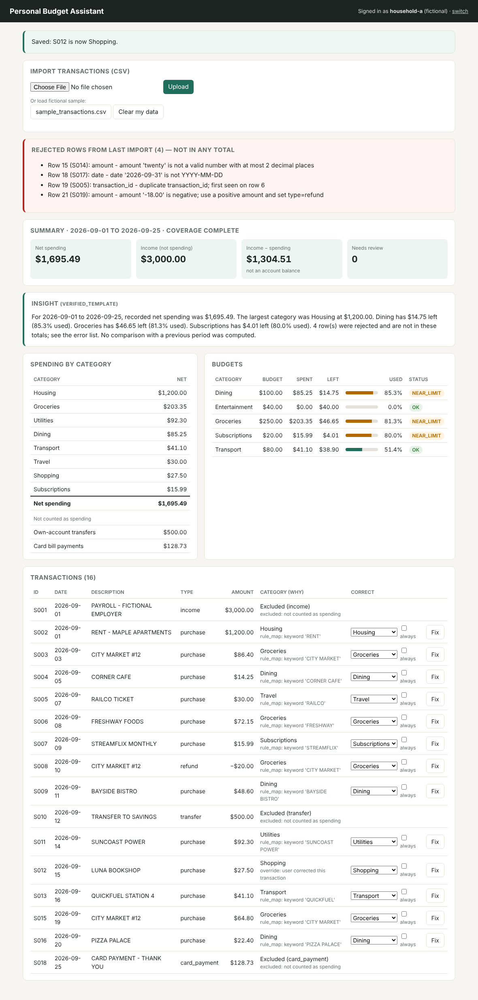
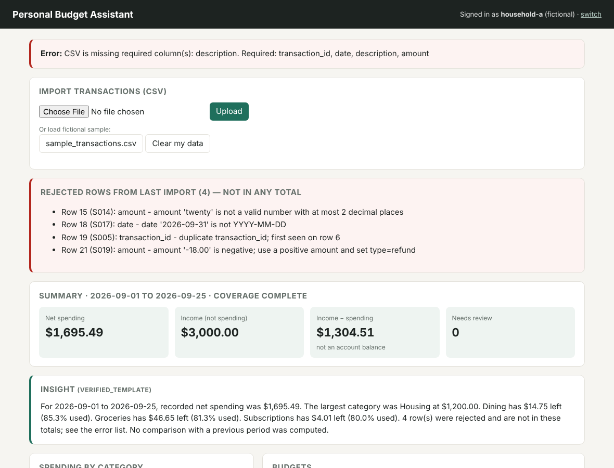

# Personal Budget Assistant

A fictional CSV spending summarizer. It categorizes purchases with a transparent
merchant-to-category rule map, calculates category totals, overall net spending
and budget status with **exact integer-cent arithmetic**, lets the user correct
categories, and **reports every invalid row instead of hiding it**.

Design principle: *AI may propose a category; tested code calculates money;
explanations describe only verified results.*

## Financial use case

**User:** a person (fictional "household") who wants to know where their money went this month.
**Decision supported:** "Am I on track with my category budgets, and what needs my attention?"

**Inputs**
- A CSV of transactions: `transaction_id, date, description, amount, type, account`
  (`type` is optional, default `purchase`).
- `data/budgets.json`: monthly budget per category, e.g. `{"Groceries": "250.00"}`.

**Outputs**
- Net spending per category and overall.
- Budget lines: budget, spent, remaining, % used, status `OK` / `NEAR_LIMIT` (≥ 80%) / `OVER`.
- Amounts *not* counted as spending (income, own-account transfers, card bill payments).
- A list of rejected rows with row number, field and reason.
- Transactions that need review (`Uncategorized`), with the reason for every category.
- A plain-language insight built only from the verified report.

### Spending policy (business rules)

| Type | Effect on spending | Why |
|---|---|---|
| `purchase` | + amount | Counted when made |
| `refund` | − amount, in the purchase's category | Reduces that category's spending |
| `income` | none | Money in, not spending |
| `transfer` | none | Moving money between the person's own accounts |
| `card_payment` | none | The card purchase was already counted; counting the bill payment again would double count |

Amounts in the CSV are always positive; the `type` decides direction. A negative
amount is rejected with a hint to use `type=refund`, rather than guessed.

### Category precedence

1. **Saved transaction override** — the user corrected *this* transaction.
2. **User merchant rule** — user explicitly chose "always" for that merchant (only for that user).
3. **Built-in rule map** — keyword list in `budget_assistant/rules.py`.
4. **Optional classifier** — used only if confidence ≥ 0.80 (interface + tests; no model shipped).
5. **Uncategorized** — stays visible in the report and flagged "needs review".

## Run and test

**Prerequisites:** Python 3.9+ (tested on 3.13). No third-party packages —
the standard library only, so there is nothing to install (`requirements.txt` is intentionally empty).

```bash
cd student-projects/personal-budget-c4e81a

# One-shot text report (nothing saved)
python3 -m budget_assistant report data/sample_transactions.csv

# Web dashboard
python3 -m budget_assistant serve          # open http://127.0.0.1:8020
```

In the browser, pick a fictional household, click **sample_transactions.csv**,
then use **Fix** on any row to correct its category.

Saved-data CLI (store defaults to `var/store.json`, git-ignored):

```bash
python3 -m budget_assistant import data/packet_q6_city_market.csv --user household-a
python3 -m budget_assistant correct T2 Dining --user household-a
python3 -m budget_assistant show --user household-a
python3 -m budget_assistant show --user household-a --partial "savings account unavailable"
```

**Tests**

```bash
python3 -m unittest discover -s tests -v
```

Windows: use `py -3` instead of `python3`.

Configuration: only `data/budgets.json` (category → dollar string). No secrets, keys or accounts are used.

## Demonstration

### Normal case
- **Input:** `data/sample_transactions.csv` (20 fictional rows), budgets from `data/budgets.json`.
- **Expected:** valid rows categorized; Groceries = 86.40 + 72.15 − 20.00 (refund) + 64.80 = **$203.35**;
  income $3,000, transfer $500 and card payment $128.73 excluded; net spending **$1,695.49**;
  `LUNA BOOKSHOP` is Uncategorized until the user corrects it.
- **Observed:** identical (see screenshot 1, after correcting S012 → Shopping; net spending unchanged).



### Failure case
- **Input:** the same sample contains 4 bad rows (`twenty` amount, `2026-09-31` date,
  duplicate ID `S005`, negative amount); then a file missing the `description` column is uploaded.
- **Expected:** bad rows are listed with row number and reason and excluded from every total; the
  file with a missing column is refused as a whole with the list of required columns.
- **Observed:** identical (screenshot 2).



### One important rule explained — "card payments are not spending"
A $80 restaurant purchase on a credit card is spending on the day it is made.
When $80 later leaves checking to pay the card bill, no new spending happens — the debt is
settled. If both were counted, Dining would look like $160. The report shows the card payment
separately under "Not counted as spending" so the user can still see it.

### Missing or conflicting evidence
- **Malformed field** → row rejected and reported; valid rows still processed.
- **Same transaction ID re-imported with identical data** → skipped as "already imported" (no double count).
- **Same ID with different data** → reported as a *conflict*; the original is kept, never silently overwritten.
- **Unknown merchant / low-confidence prediction / classifier outage** → `Uncategorized`, flagged for review.
- **Partial coverage** (e.g. an account unavailable) → report marked `PARTIAL` and the insight says so.
- **Insight generator fails or makes an unsupported claim** → the verified template insight is shown; numbers are never blocked.

## Verification and modification

Actual result on Python 3.13 (Linux), command `python3 -m unittest discover -s tests -v`:

```
Ran 40 tests in 0.522s
OK
```

Tests cover normal, failure and boundary cases, including every calculation scenario in the
course question packet:

| Test file | What it proves |
|---|---|
| `test_money_and_ingest.py` | exact cents; `twenty`, blank, negative, zero, 3-decimal, NaN, huge amounts rejected; bad date/type/blank/duplicate rows reported with row numbers; missing columns refused |
| `test_report_and_corrections.py` | spending policy ($1,460 example, grocery 72% / $70 left); over/at budget; refunds; uncategorized stays visible; classifier threshold and outage; correction moves money between categories but not the total; correction survives restart and re-import; does not touch T1 or another customer; repeated import stays $50; conflicting IDs |
| `test_insights_and_evaluation.py` | unsupported narrative ("down 40% from August… safely spend $400") is caught and replaced; generator timeout falls back; precision 80%, recall 90%, accuracy 87%, dollar MAE $100 |
| `test_web.py` | real HTTP: upload, rejected rows shown, household B cannot see or correct household A's data, unauthenticated POST refused |

**Small change I made and tested:** added a `NEAR_LIMIT` budget status at ≥ 80% used, between
`OK` and `OVER`, so the user gets a warning *before* overspending. Spending exactly the budget is
`NEAR_LIMIT`, not `OVER` (`test_exactly_at_budget_is_not_over`); $180 of $250 (72%) stays `OK`
(`test_grocery_budget`); $180 of $150 is `OVER` with −$30 remaining (`test_over_budget_status`).

## Limits and AI assistance

- Demo sign-in is a cookie choosing one of two fictional households — **not real authentication**.
  Data isolation is enforced in the server/store (every call takes the user ID), but production
  would need proper identity (e.g. Identity Platform / IAP).
- JSON file storage, single-process server; fine for a demo, not for concurrent users.
- Rule map is keyword-based and small; real merchant descriptions need a larger map or a trained classifier.
- Refunds are categorized by their own description; a refund is not yet linked to its original purchase ID.
- One currency (USD); no pending/posted distinction; no bank connection.
- "Income minus spending" is **not** an account balance (needs opening balance and account-level flows).
- No runtime AI is shipped. The classifier and insight-generator hooks are tested with stand-in
  functions to prove the safety behavior (threshold, fallback, narrative check).

AI assistance is documented in [`AI_USAGE.md`](AI_USAGE.md). Architecture, cloud mapping and the
ML approach are in [`docs/DESIGN.md`](docs/DESIGN.md).

## Data

All data is fictional (made-up merchants like "CITY MARKET", "BAYSIDE BISTRO", "RAILCO").
Fields: `transaction_id` (stable ID from the source), `date` (YYYY-MM-DD), `description`
(merchant text), `amount` (positive, ≤ 2 decimals), `type` (purchase/refund/income/transfer/card_payment),
`account` (free-text label). The `packet_*.csv` files reproduce the course's worked examples.
No names, contact details, IDs, grades, credentials or real financial records are included.
