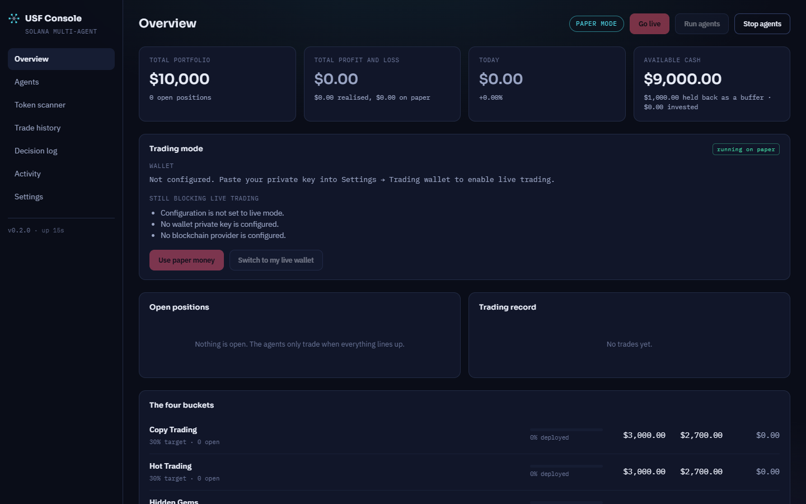
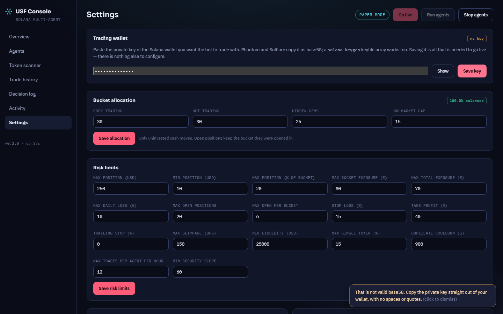

# Solana multi-agent trading bot

## Financial use case

**User:** someone researching automated crypto trading who wants to see every
decision and its reason before risking money.

**Decision:** should this Solana token be bought, how much, and from which budget?

**Inputs:** public market data (DexScreener, Jupiter), and optionally on-chain
security data (Helius), social data (LunarCrush, news feeds) and a configurable
risk policy.

**Outputs:** a signal or a recorded refusal with its reason, a simulated trade,
portfolio figures per budget bucket, and a durable decision log.

```
Agent → Signal Engine → Security → Risk Manager → Portfolio → Execution → Database
```

Agents only produce signals. They cannot execute or reach the wallet, and any
later gate can stop a trade. The application defaults to paper trading with a
simulated $10,000 balance. See [docs/OVERVIEW.md](docs/OVERVIEW.md) for the agents,
buckets and safety model, and [docs/ARCHITECTURE.md](docs/ARCHITECTURE.md) for the layers.

## Run and test

**Prerequisites:** Node.js 20.11 or newer (`engines` in `package.json`). Verified
here on Node 25.9.0 with npm 11.7.0. Dependencies are pinned by `package-lock.json`.

From this folder:

```sh
npm ci
cp .env.example .env
npm run migrate
npm run build
npm start
```

| Page | Local URL |
|---|---|
| Trading console | http://127.0.0.1:8787/app/ |
| Landing page | http://127.0.0.1:8787/ |
| API status | http://127.0.0.1:8787/api/status |

Test and typecheck:

```sh
npm test
npm run typecheck
```

**Configuration:** [.env.example](.env.example) contains placeholders only. Paper mode
runs with every key left blank. Never commit `.env`. Environment variables already
set on your machine, such as `OPENROUTER_API_KEY`, are also picked up.

## Demonstration

Both cases were run on a clean database, in paper mode, with no API keys and no wallet.

### Normal case: paper-mode scan

- **Input:** `POST /api/agents/{id}/run` for Hot Trade, Hidden Gem and Small Market Cap,
  against public DexScreener data.
- **Expected:** tokens are screened, those that fail are refused with a reason, and no
  real money or wallet is involved.
- **Observed:** Hot Trade scanned 55 tokens, Hidden Gem 53 and Small Market Cap 53. All
  were filtered, producing 0 signals and 0 trades, with reasons in the decision log. The
  portfolio stayed at $10,000. Small Market Cap and Copy Trade reported themselves as
  degraded because no on-chain provider was configured. Results depend on live market
  data and will differ between runs.



### Failure case: invalid wallet key

- **Input:** the fictional text `not-a-real-key` entered in Settings → Trading wallet.
- **Expected:** the key is rejected and nothing is stored.
- **Observed:** the console showed "That is not valid base58. Copy the private key
  straight out of your wallet, with no spaces or quotes." and the wallet stayed at
  `no key`.



Also captured: [agents and live flow](docs/screenshots/02-agents.png),
[token scanner](docs/screenshots/03-token-scanner.png) and
[decision log](docs/screenshots/04-decision-log.png).

Requesting live mode in the same state was refused too. `POST /api/control/mode` returned
`effectiveMode: "paper"` with the blockers "No wallet private key is configured." and
"No blockchain provider is configured."

### Business rule: live trading fails closed on missing security data

Every trade passes the token security gate first. If no security provider can supply
data, the evidence is missing, so the result depends on the mode:

- **Live mode:** the token is always rejected with a critical flag, and setting
  `security.failClosed` to false cannot change this. Missing data never counts as safe
  when real money is at stake.
- **Paper mode:** by default the token continues with a score penalty, so the rest of the
  pipeline stays observable. `security.failClosed` makes paper match live.

Both behaviors are tested in `apps/server/test/security.test.ts`.

**Conflicting evidence** is also refused. A token that claims a well-known symbol such as
USDC or JUP while its mint address does not match the real one is rejected, as is one
reporting a market cap that is not credible. Examples appear in the Ingest column of the
[agents screenshot](docs/screenshots/02-agents.png).

## Verification and modification

Actual results from this submission's code:

```text
npm test            Test Files 10 passed (10), Tests 117 passed (117)
npm run typecheck   server and dashboard, no errors
```

**Small modification:** the default hard ceiling on a single trade, `risk.maxPositionUsd`,
was lowered from $500 to $250 in `apps/server/src/config/defaults.ts`.

- **Why:** to limit how much one bad trade can cost. A $500 position is 5% of the $10,000
  paper balance, and $250 is 2.5%. At $250 the ceiling also matches the largest default agent
  request, so raising an agent's own `maxTradeUsd` cannot push a trade above it.
- **Behavior:** an oversized request is shrunk to the cap rather than refused. With default
  settings, agents already request $250 or less, so typical trade sizes do not change. The
  cap is a backstop.
- **Check:** tests in `apps/server/test/portfolio-risk.test.ts` confirm the default is 250, a
  $250 request stays at $250, a $251 request becomes $250, a $99,999 request becomes $250, and
  a $100 request stays at $100. Run against the old $500 value, two of these tests failed with
  `expected 500 to be 250`, and all 117 passed after the change.
- **Existing installs:** a configuration already saved in a local database takes priority over
  this default. Change it in Settings → Risk limits, or start with a new database.

## Limits and AI assistance

- **Research project only.** This is not financial advice. Automated trading can lose
  money quickly, and small-cap tokens can lose all of it.
- **Live trading is not demonstrated.** The demonstrations and screenshots cover paper
  mode only.
- **Paper results are simulated.** They do not prove profitability.
- **Keyless runs are limited.** Without Helius there is no on-chain security or holder
  data, and Copy Trade and Small Market Cap run degraded.
- **Free feeds can be rate limited.** The news feed returned HTTP 429 on 2 of 6 calls in
  the demonstration run.
- **Known dependency advisories.** `npm audit` reports 19 advisories (2 critical, 5 high,
  12 moderate), 11 of them in production dependencies (2 high, 9 moderate). They have not
  been fixed, because some fixes need breaking upgrades.
- **Local use only.** The API has no login and defaults to localhost. Do not expose it to
  a network.

AI assistance is recorded in [AI_USAGE.md](AI_USAGE.md).

**Runtime AI (optional):** OpenRouter can write plain-language trade summaries, using
`OPENROUTER_MODEL` (default `meta-llama/llama-3.3-70b-instruct:free`) and
`OPENROUTER_API_KEY`. It adds no extra dependency. Decisions come from deterministic rules,
and without a key they keep their full deterministic explanation. It was not used in the
demonstrations above.

## Data

- **Test data is fictional.** Fixtures in `apps/server/test/helpers.ts` use made-up tokens
  such as `TEST` at a placeholder address.
- **The paper balance is simulated.** No real funds or personal financial records are used.
- **Screenshots show real public market data.** Token symbols, prices and addresses come
  from DexScreener. They are public market listings, not personal records, and nothing here
  recommends them.
- **No private data is included.** The repository holds no secrets, names, contact details,
  IDs, grades or real financial records. The wallet key shown in the failure case is
  fictional text.

MIT licensed. See [LICENSE](LICENSE).
